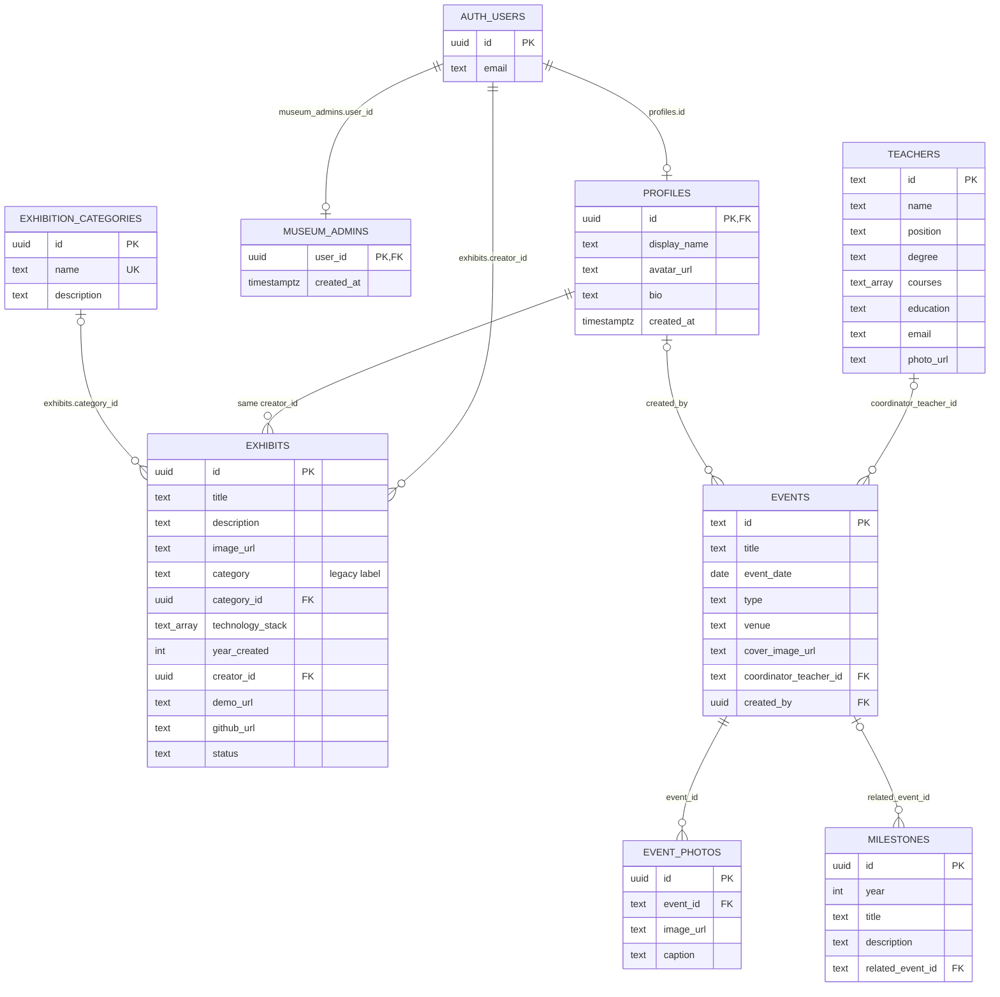

# ISM Digital Museum — Physical ERD (Supabase PostgreSQL)

> Supabase project: `SWE334_ISMmuseum` (`eycvjafolcdyjrpjxxqh`). Энэ ERD нь 2026-11-09-нд бодитоор үүсгэсэн FK constraint-уудыг харуулна.
> Нийт: **8 public хүснэгт, 9 foreign key constraint, 8/8 RLS**; Supabase `auth.users` нь тусдаа managed authentication хүснэгт.

## FK тайлбар

| № | Child → parent | Утга |
|---|---|---|
| 1 | `profiles.id → auth.users.id` | Auth хэрэглэгчийн профайл (1:0..1) |
| 2 | `museum_admins.user_id → auth.users.id` | Зөвшөөрөгдсөн админ (1:0..1) |
| 3 | `exhibits.creator_id → auth.users.id` | Үзмэр оруулсан хэрэглэгч |
| 4 | `exhibits.creator_id → profiles.id` | Оюутны профайлтай шууд холбох нэмэлт FK |
| 5 | `exhibits.category_id → exhibition_categories.id` | Бүтээлийн жинхэнэ ангиллын холбоо |
| 6 | `events.coordinator_teacher_id → teachers.id` | Арга хэмжээний хариуцсан багш (сонголтот) |
| 7 | `events.created_by → profiles.id` | Системд бичлэг нэмсэн хэрэглэгч (сонголтот) |
| 8 | `event_photos.event_id → events.id` | Арга хэмжээний олон зураг |
| 9 | `milestones.related_event_id → events.id` | Түүхэн үйл явдлын холбогдох өдөрлөг (сонголтот) |

**Анхаарах:** `exhibits.creator_id` талбар нь `auth.users` ба `profiles` руу зэрэг FK-тэй. `profiles.id` нь мөн `auth.users.id` байдаг тул энэ нь давхардсан identity-г ил тод баталгаажуулж байна. `exhibits.category` текстэн талбарыг хуучин өгөгдөл болон UI-тай нийцүүлэх зорилгоор хадгалж, шинэ CRUD үед `category_id`-г ангиллын нэрээр олж хадгалдаг.

Одоогоор seed өгөгдөлд хариуцсан багш, холбогдох event, анхны бичлэгийг үүсгэсэн хэрэглэгч баттай тэмдэглэгдээгүй. Иймээс **сонголтот FK талбарууд NULL** бөгөөд мэдээлэл зохиож дүүргээгүй. Үүнийг багш/админ баталгаажуулсан үед бөглөнө.

## Security / Storage

- Public schema: 8/8 хүснэгтэд RLS enable.
- Оюутан: өөрийн бүтээл, профайлыг засна; админ: нийтлэх, хянах, удирдах.
- Зургийн bucket: `museum-assets`; public view, upload/write policy checked by user owner/admin.
- Migration: `supabase/connect_relationships.sql` (шинэ FK холбоосуудыг даалгаврын тайланд хавсаргана).
